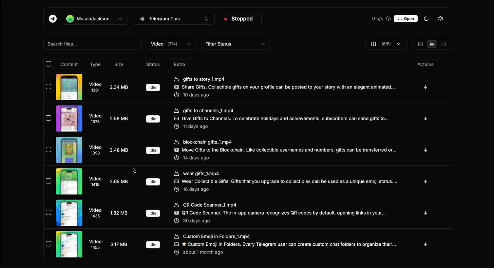
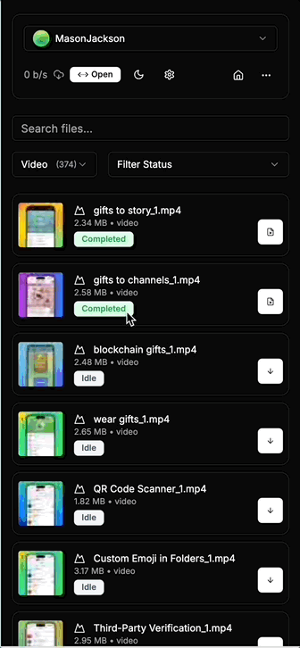

<p align="center">
  
</p>
<p align="center"><h1 align="center">Telegram Files</h1></p>
<p align="center">
  <strong>自托管的 Telegram 文件下载器</strong>
</p>
<p align="center">
  🇨🇳 中文界面 | 📁 优化分组 | 🐳 多平台镜像 | ⚡ GitHub Actions CI
</p>
<p align="center">
  <a href="https://github.com/rboyy/telegram-files/blob/main/LICENSE">
    
  </a>
  <a href="https://github.com/rboyy/telegram-files/commits">
    
  </a>
  <a href="https://github.com/rboyy/telegram-files/stargazers">
    
  </a>
</p>

---

## ✨ 优化特性

本版本基于原版 telegram-files（当前已同步至上游 `0.4.0`，本版本号 `3.6`）进行了以下优化：

- **中文界面** - 完整的简体中文翻译，所有按钮、提示、错误消息都已汉化
- **优化分组** - GROUP_BY_CHAT 策略使用频道/群组名称代替数字 ID，更直观的文件夹结构
- **多平台支持** - 提供 linux/amd64 和 linux/arm64 镜像，适用于各种服务器环境
- **文件路径优化** - 自动清理文件名中的非法字符，避免创建失败
- **性能优化** - 文件列表渲染与并发下载调度优化，大列表滚动更流畅
- **安全加固** - 排序字段与 AI 分类路径做了白名单校验，避免非法输入
- **批量操作** - 新增「一键删除所有已完成文件」，清理更快
- **版本检测** - 关于页面直接读取 Docker Hub 镜像标签，无需 GitHub Releases

上游 `0.4.0` 的新能力同样已包含：文件分享与 Seed 分发、Passkey 登录、管理员账户与首次启动引导、
TDLib 升级至 1.8.66、缩略图预加载、连接感知的自动重连。

---

## 🚀 快速开始

### 前置要求

首先需要申请 Telegram API ID 和 Hash，访问 [Telegram API](https://my.telegram.org/apps) 申请。

### 使用安装脚本（推荐）

交互式脚本可完成安装、配置、停止与更新（支持 Linux amd64/arm64）：

```sh
curl -fsSL https://raw.githubusercontent.com/rboyy/telegram-files/main/scripts/deploy.sh | bash
```

<details closed>
<summary>脚本子命令说明</summary>

也可以直接执行子命令：

```sh
./scripts/deploy.sh start    # 安装并启动服务
./scripts/deploy.sh stop     # 停止服务
./scripts/deploy.sh update   # 拉取最新镜像并重启
./scripts/deploy.sh restart  # 重启服务
./scripts/deploy.sh status   # 查看容器状态
./scripts/deploy.sh logs     # 实时查看日志
./scripts/deploy.sh config   # 修改环境配置
```

</details>

### 使用 Docker

```bash
docker run -d \
  --name telegram-files \
  --restart always \
  -e APP_ENV=${APP_ENV:-prod} \
  -e APP_ROOT=${APP_ROOT:-/app/data} \
  -e HTTP_SECURE_COOKIES=${HTTP_SECURE_COOKIES:-false} \
  -e TELEGRAM_API_ID=你的API_ID \
  -e TELEGRAM_API_HASH=你的API_HASH \
  -p 6543:80 \
  -v ./data:/app/data \
  rboyy/telegram-files:latest
```

### 使用 docker-compose

复制 `docker-compose.yaml` 和 `.env.example` 到你的目录，编辑 `.env` 填写 API 配置，然后运行：

```bash
docker-compose up -d
```

### 在 unRaid 上安装

在 unRaid 的应用商店（Community Repositories）中搜索 `telegram-files` 安装。

> **安全提示：** 管理接口、文件预览和 WebSocket 都需要管理员登录后才能访问。请启用 HTTPS，
> 配置 `HTTP_ALLOWED_ORIGINS`，并在对外暴露服务前完成首个管理员的引导设置。

首次启动时，API 会在日志中打印一个 15 分钟内有效的一次性引导码。请从本机回环地址或同一内网打开
网页，先创建第一个管理员账户，再考虑对外暴露。使用反向代理时必须保留 `X-Real-IP`、`X-Forwarded-Host`
和 `X-Forwarded-Proto` 三个请求头，镜像内置的 Nginx 配置已经做了这件事。

管理员密码找回只能在本地执行，并且会使所有已登录会话失效：

```sh
java -cp api/build/libs/telegram-files.jar telegram.files.Maintain admin reset-password owner
java -cp api/build/libs/telegram-files.jar telegram.files.Maintain admin apply-reset owner
```

访问 http://localhost:6543 即可使用！

---

## 📝 功能介绍

- ✅ 从 Telegram 频道和群组下载文件
- ✅ 支持多个 Telegram 账户同时管理
- ✅ 随时暂停和恢复下载
- ✅ 自动转移文件到指定目录（支持按频道名称分组）
- ✅ 即时预览下载的视频和图片
- ✅ 完全响应式设计，支持移动端
- ✅ PWA 支持和离线功能
- ✅ 从 Telegram 分享链接获取文件
- ✅ 按规则自动下载，并提供下载统计与报表
- ✅ 将文件分享到 Seed 平台，支持种子下载

---

## 🧩 截图

<div align="center">
  
  
</div>

---

## ⚠️ 重要提示

**请不要将服务暴露到公共互联网！** 该服务不是为公共访问设计的。

---

## 🆗 常见问题

**Q.** 网页里的剧透遮罩（spoiler）是静止的，怎么解决？

**A.** 1. 因为并非所有浏览器都支持 `CSS Houdini Paint API`。2. 该 API 只在 https 下可用。

<details closed>
<summary>在 http 环境下使用时，可以用下面的方法解决</summary>

打开 `chrome://flags` 页面，搜索 `Insecure origins treated as secure`，把网页地址加入白名单。

</details>

**Q.** 如何使用 telegram-files 的维护工具？

**A.** 可以用下面的命令运行维护工具（**运行前请先停止 telegram-files 容器**）：

<details closed>
<summary>命令</summary>

```shell
docker run --rm \
  --entrypoint tfm \
  -v $(pwd)/data:/app/data \
  -e APP_ROOT=${APP_ROOT:-/app/data} \
  -e TELEGRAM_API_ID=${TELEGRAM_API_ID} \
  -e TELEGRAM_API_HASH=${TELEGRAM_API_HASH} \
  rboyy/telegram-files:latest ${Maintenance Command}
```

**维护命令：**

- `album-caption`：修复 `0.1.15` 之前图集消息缺少描述文字的问题。
- `thumbnail`：修复缩略图缺失的问题。
- `admin reset-password <用户名>`：生成一次性的本地管理员恢复码，并撤销所有活跃会话。
- `admin apply-reset <用户名>`：应用恢复码并以交互方式设置新的管理员密码。

</details>

---

## 📌 相关链接

- 原版项目：[jarvis2f/telegram-files](https://github.com/jarvis2f/telegram-files)
- 此优化版：[rboyy/telegram-files](https://github.com/rboyy/telegram-files)

---

## 📄 许可证

MIT License - 详见 [LICENSE](LICENSE) 文件。

---

<p align="center">
  Made with ❤️ by <a href="https://github.com/rboyy">RBoy</a>
</p>
